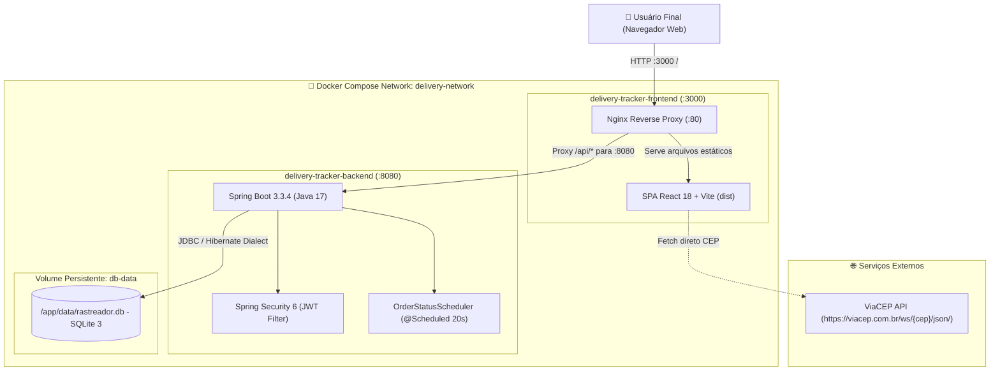
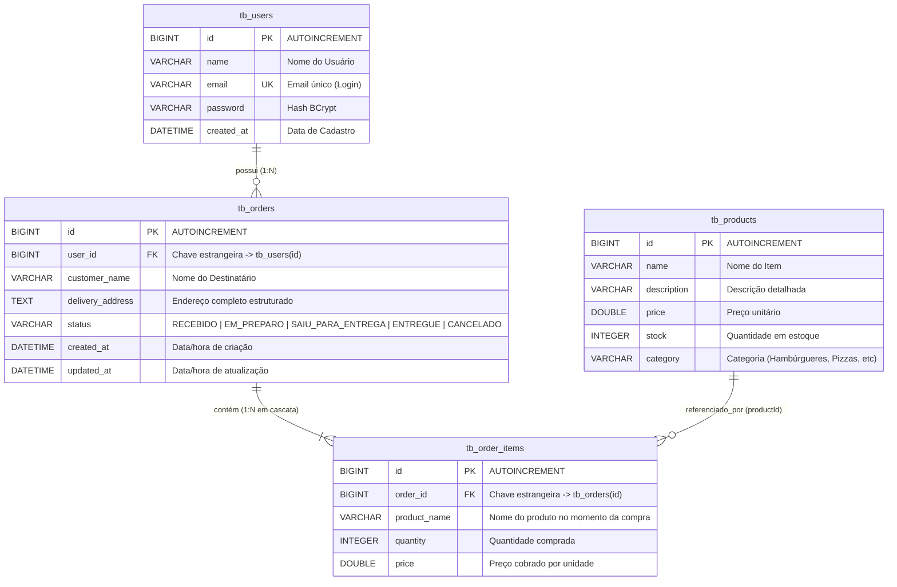
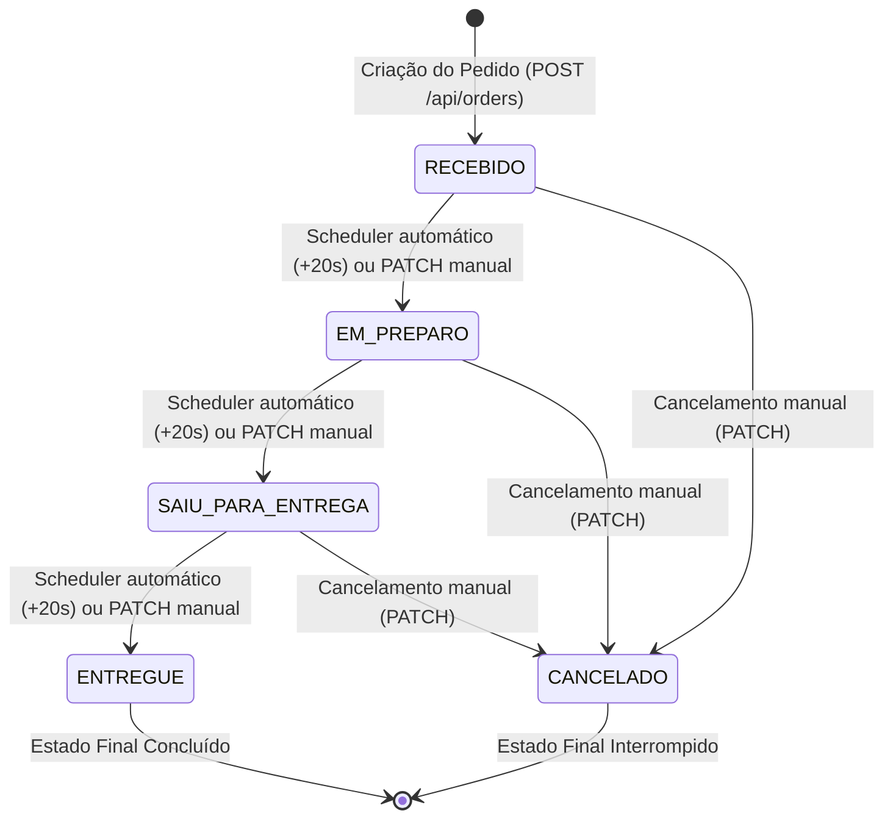
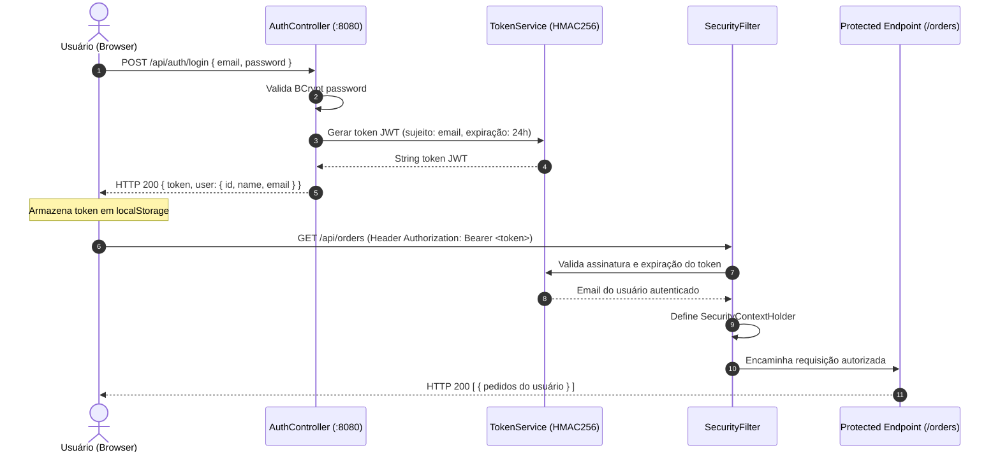

# Software Design Description (SDD) — FoodyDelivery
> **Documento de Arquitetura e Engenharia de Software para Agentes de IA e Desenvolvedores**  
> **Versão:** 1.0.0  
> **Última Atualização:** 2026-10-18  
> **Repositório:** `rfurlanetto/FoodyDeliveri`

---

## 📑 Sumário Executivo

O **FoodyDelivery** é uma plataforma full-stack para realização, gerenciamento e rastreamento em tempo real do ciclo de vida de pedidos gastronômicos. O ecossistema é composto por um backend em **Spring Boot 3** (Java 17) com persistência em **SQLite**, um frontend SPA em **React 18** (Vite) servido por **Nginx**, e orquestração de contêineres via **Docker Compose**.

Este documento (SDD) foi especialmente estruturado para servir de **fonte única da verdade (Single Source of Truth - SSOT)**, permitindo que qualquer **Inteligência Artificial (LLM/Agent)** ou engenheiro humano compreenda instantaneamente as premissas arquiteturais, modelos de dados, contratos de API, máquinas de estado e regras de negócio sem necessidade de contexto prévio.

---

## 1. Visão Geral da Arquitetura

### 1.1 Diagrama de Arquitetura de Alto Nível (C4 Context)



### 1.2 Componentes e Pilha Tecnológica

| Camada | Tecnologia / Biblioteca | Função Principal |
| :--- | :--- | :--- |
| **Frontend Runtime** | React 18.2, Vite 5 | SPA responsiva, reativa e modular |
| **Frontend Routing** | React Router DOM v6 | Controle de rotas públicas e rotas protegidas por JWT |
| **Frontend HTTP** | Axios 1.6 | Requisições HTTP com interceptors para injeção de Bearer Token |
| **Frontend Styling** | Vanilla CSS (CSS Variables) | Design System proprietário com glassmorphism, temas e responsividade |
| **Web Server / Proxy** | Nginx Alpine | Servidor web para o build do frontend e Proxy Reverso para `/api` |
| **Backend Runtime** | Java 17 (Eclipse Temurin) | Linguagem tipada e robusta com Garbage Collector moderno |
| **Backend Framework** | Spring Boot 3.3.4 | Core framework (Spring MVC, Spring Data JPA, Spring Security 6) |
| **Segurança / Auth** | Auth0 `java-jwt` 4.4.0 + BCrypt | Emissão/validação stateless de tokens JWT (validade de 24h) |
| **Banco de Dados** | SQLite 3 (`sqlite-jdbc` 3.45.1) | Persistência relacional leve e autocontida |
| **ORM / Dialeto** | Hibernate Community SQLite Dialect | Mapeamento Objeto-Relacional JPA para SQLite |
| **Containerização** | Docker & Docker Compose | Ambientes isolados com build multi-stage e volume de dados compartilhado |

---

## 2. Modelo de Dados e Persistência

### 2.1 Diagrama Entidade-Relacionamento (ERD)



### 2.2 Dicionário de Tabelas

#### `tb_users`
- Armazena credenciais e perfil dos usuários cadastrados.
- **Índice único:** `email` (impede registros duplicados).
- **Senha:** Hash salted gerado via Spring Security `BCryptPasswordEncoder`.

#### `tb_products`
- Catálogo oficial da loja, inicializado automaticamente via `DataInitializer.java` com 50 itens divididos em 5 categorias (`Hambúrgueres`, `Pizzas`, `Acompanhamentos`, `Bebidas`, `Sobremesas`).
- Cada item começa com 10 unidades de estoque inicial caso a base esteja vazia.

#### `tb_orders`
- Entidade principal de pedidos. Possui relacionamento `@ManyToOne` com `User`.
- `status` é regido pelo enum `OrderStatus`.
- `delivery_address` armazena a concatenação validada do CEP e logradouro via ViaCEP.

#### `tb_order_items`
- Relacionamento `@OneToMany(cascade = CascadeType.ALL, orphanRemoval = true)` a partir de `Order`.
- Grava snapshot histórico do `product_name` e `price` unitário para auditoria inalterável.

---

## 3. Regras de Negócio e Máquina de Estados

### 3.1 Ciclo de Vida do Pedido (Finite State Machine)



#### Transição Automática (`OrderStatusScheduler.java`):
- Executado via `@Scheduled(fixedRateString = "${app.scheduler.status-interval-ms:20000}")`.
- Busca pedidos nos status ativos (`RECEBIDO`, `EM_PREPARO`, `SAIU_PARA_ENTREGA`) ordenados por data de criação.
- Atualiza o status para a próxima etapa cronológica e persiste no banco SQLite.

### 3.2 Controle Atômico de Estoque (`OrderService.java`)
1. **Transacionalidade:** O método `createOrder` é anotado com `@Transactional`.
2. **Validação Prévia:** Para cada item do pedido que contenha `productId`:
   - Verifica se o produto existe em `tb_products`.
   - Se `product.getStock() < item.getQuantity()`, aborta a operação disparando `InsufficientStockException`.
   - Se o estoque for suficiente, subtrai a quantidade: `product.setStock(product.getStock() - item.getQuantity())` e salva.
3. **Tratamento de Exceção:** `GlobalExceptionHandler` intercepta a exceção e retorna status `HTTP 400 Bad Request` com payload padronizado:
   ```json
   {
     "timestamp": "2026-10-18T19:00:00",
     "status": 400,
     "error": "Estoque Insuficiente",
     "message": "Estoque insuficiente para o produto 'X'. Disponível: 2, Solicitado: 5"
   }
   ```

### 3.3 Integração e Bloqueio de Endereço ViaCEP
1. **Consulta via CEP:** O usuário digita o CEP no frontend (`CreateOrder.jsx`).
2. **Lookup Externo:** Requisição assíncrona para `https://viacep.com.br/ws/{cep}/json/`.
3. **Preenchimento e Travamento (Read-only):**
   - `Logradouro`, `Bairro`, `Cidade` e `Estado` são preenchidos automaticamente e recebem o estado `readOnly` com badge `🔒 ViaCEP` para evitar dados incorretos de entrega.
4. **Campos Manuais:**
   - `Número`: Obrigatório, editável em linha própria.
   - `Complemento`: Opcional, editável em linha própria.
5. **Composição Salva no Pedido:**
   ```
   {Logradouro}, {Número} - {Complemento} - Bairro {Bairro}, {Cidade} - {UF}, CEP: {CEP}
   ```

### 3.4 Pré-preenchimento da Sessão do Usuário
- Ao carregar a tela de novo pedido (`/orders/new`), o sistema busca o usuário autenticado na sessão (`AuthContext`).
- O campo **"Nome do Destinatário"** é preenchido automaticamente com `user.name`, mas permanece **totalmente editável** caso o pedido seja para outra pessoa.
- O último endereço utilizado é preservado no `localStorage` sob a chave `foody_last_address` para agilizar pedidos subsequentes.

---

## 4. Segurança e Autenticação

### 4.1 Fluxo de Autenticação JWT



### 4.2 Regras de Autorização (`SecurityConfig.java`)
- **Rotas Públicas (Sem Token):**
  - `POST /api/auth/register`
  - `POST /api/auth/login`
- **Rotas Protegidas (Exigem Bearer Token):**
  - `GET /api/auth/me`
  - `GET /api/products` e `GET /api/products/{id}`
  - `GET /api/orders`, `POST /api/orders`, `GET /api/orders/{id}`, `PATCH /api/orders/{id}/status`
- **Tratamento de Sessão Expirada / 401:**
  - O interceptor do `api.js` captura respostas 401. Caso o erro não tenha ocorrido na tela de login, limpa o token e redireciona suavemente para `/login` sem criar loops infinitos de reload.

---

## 5. Catálogo Completo da API REST

Todas as rotas são prefixadas por `/api`.

### 5.1 Módulo de Autenticação

#### `POST /api/auth/register`
Cria uma nova conta de usuário.
- **Request Body:**
  ```json
  {
    "name": "Renê Furlanetto",
    "email": "cliente@foodydelivery.com",
    "password": "senha_segura"
  }
  ```
- **Response 201 Created:**
  ```json
  {
    "token": "eyJhbGciOiJIUzI1NiIsInR5cCI6IkpXVCJ9...",
    "user": {
      "id": 1,
      "name": "Renê Furlanetto",
      "email": "cliente@foodydelivery.com"
    }
  }
  ```

#### `POST /api/auth/login`
Autentica o usuário e emite o token JWT.
- **Request Body:**
  ```json
  {
    "email": "cliente@foodydelivery.com",
    "password": "senha_segura"
  }
  ```
- **Response 200 OK:**
  ```json
  {
    "token": "eyJhbGciOiJIUzI1NiIsInR5cCI6IkpXVCJ9...",
    "user": {
      "id": 1,
      "name": "Renê Furlanetto",
      "email": "cliente@foodydelivery.com"
    }
  }
  ```

#### `GET /api/auth/me`
Retorna dados do usuário autenticado no token corrente.
- **Headers:** `Authorization: Bearer <token>`
- **Response 200 OK:**
  ```json
  {
    "id": 1,
    "name": "Renê Furlanetto",
    "email": "cliente@foodydelivery.com"
  }
  ```

---

### 5.2 Módulo de Produtos & Estoque

#### `GET /api/products`
Retorna o cardápio completo com quantidade em estoque em tempo real.
- **Headers:** `Authorization: Bearer <token>`
- **Response 200 OK:**
  ```json
  [
    {
      "id": 1,
      "name": "Hambúrguer Clássico Artesanal",
      "description": "Pão brioche tostado na manteiga, blend bovino 180g...",
      "price": 28.90,
      "stock": 10,
      "category": "Hambúrgueres"
    }
  ]
  ```

#### `GET /api/products/{id}`
Retorna os detalhes de um produto específico.
- **Headers:** `Authorization: Bearer <token>`
- **Response 200 OK:** Objeto do produto.
- **Response 404 Not Found:** Se o ID não existir.

---

### 5.3 Módulo de Pedidos

#### `POST /api/orders`
Cria um pedido vinculado ao usuário autenticado e subtrai o estoque atomicamente.
- **Headers:** `Authorization: Bearer <token>`
- **Request Body:**
  ```json
  {
    "customerName": "Renê Furlanetto",
    "deliveryAddress": "Rua Tomé Álvares de Castro, 98 - Apto 23G - Bairro Vila Carmosina, São Paulo - SP, CEP: 08290-270",
    "items": [
      {
        "productId": 1,
        "productName": "Hambúrguer Clássico Artesanal",
        "quantity": 2,
        "price": 28.90
      }
    ]
  }
  ```
- **Response 201 Created:**
  ```json
  {
    "id": 1,
    "customerName": "Renê Furlanetto",
    "deliveryAddress": "Rua Tomé Álvares de Castro, 98...",
    "status": "RECEBIDO",
    "createdAt": "2026-10-18T19:30:00",
    "updatedAt": "2026-10-18T19:30:00",
    "total": 57.80,
    "items": [
      {
        "id": 1,
        "productName": "Hambúrguer Clássico Artesanal",
        "quantity": 2,
        "price": 28.90,
        "subtotal": 57.80
      }
    ]
  }
  ```
- **Response 400 Bad Request:** Se a quantidade solicitada for maior que o estoque disponível.

#### `GET /api/orders`
Retorna todos os pedidos pertencentes ao usuário logado.
- **Headers:** `Authorization: Bearer <token>`
- **Response 200 OK:** Lista ordenada dos pedidos do usuário.

#### `GET /api/orders/{id}`
Retorna os detalhes e itens de um pedido específico.
- **Headers:** `Authorization: Bearer <token>`
- **Response 200 OK:** Objeto detalhado do pedido.
- **Response 404 Not Found:** Caso o ID não exista ou pertença a outro usuário.

#### `PATCH /api/orders/{id}/status`
Atualiza manualmente o status de um pedido.
- **Headers:** `Authorization: Bearer <token>`
- **Request Body:**
  ```json
  {
    "status": "EM_PREPARO"
  }
  ```
- **Status válidos:** `RECEBIDO`, `EM_PREPARO`, `SAIU_PARA_ENTREGA`, `ENTREGUE`, `CANCELADO`.

---

## 6. Arquitetura Frontend e Estrutura de Telas

### 6.1 Árvore de Diretórios Frontend
```
frontend/src/
├── components/
│   ├── Navbar.jsx / Navbar.css          # Cabeçalho com status de auth, dados da sessão e logout
│   ├── OrderCard.jsx / OrderCard.css    # Card de resumo do pedido com badge e valores
│   ├── ProtectedRoute.jsx               # HOC / Wrapper que exige autenticação
│   └── StatusBadge.jsx / StatusBadge.css# Badge com cores dinâmicas para cada OrderStatus
├── contexts/
│   └── AuthContext.jsx                  # Estado global de autenticação (user, token, login, logout)
├── pages/
│   ├── Login.jsx / Login.css            # Formulário de login com banner de erro dismissível
│   ├── Register.jsx                     # Cadastro de novo usuário
│   ├── OrderList.jsx / OrderList.css    # Listagem de pedidos com botão compacto "+ Novo Pedido"
│   ├── OrderDetails.jsx / .css          # Detalhes, rastreamento e endereço com word-break
│   └── CreateOrder.jsx / .css           # Cardápio interativo, ViaCEP e resumo com pré-preenchimento
├── services/
│   └── api.js                           # Instância Axios com base URL '/api' e auth interceptors
├── App.jsx                              # Definição das rotas (React Router v6)
├── index.css                            # Variáveis de CSS globais, reset e tipografia
└── main.jsx                             # Bootstrap do React DOM
```

### 6.2 Rotas do Frontend
| Rota | Componente | Protegida? | Descrição |
| :--- | :--- | :--- | :--- |
| `/login` | `Login.jsx` | Não | Autenticação por email e senha |
| `/register` | `Register.jsx` | Não | Cadastro de nova conta |
| `/orders` | `OrderList.jsx` | Sim | Meus Pedidos com botão compacto de criação |
| `/orders/new` | `CreateOrder.jsx` | Sim | Criação de pedido com 50 produtos, estoque e ViaCEP |
| `/orders/:id` | `OrderDetails.jsx` | Sim | Detalhes do pedido, itens e acompanhamento de status |
| `*` | Redirect | - | Redireciona para `/orders` (se autenticado) ou `/login` |

---

## 7. Infraestrutura, Docker e Execução

### 7.1 Mapeamento de Serviços (`docker-compose.yml`)

```yaml
services:
  backend:
    build:
      context: .
      dockerfile: Dockerfile
    container_name: delivery-tracker-backend
    ports:
      - "8080:8080"
    volumes:
      - db-data:/app/data
    environment:
      - SPRING_DATASOURCE_URL=jdbc:sqlite:/app/data/rastreador.db
    networks:
      - delivery-network

  frontend:
    build:
      context: ./frontend
      dockerfile: Dockerfile
    container_name: delivery-tracker-frontend
    ports:
      - "3000:80"
    depends_on:
      - backend
    networks:
      - delivery-network

volumes:
  db-data:

networks:
  delivery-network:
    driver: bridge
```

### 7.2 Comandos Operacionais

#### Iniciar Todo o Ambiente:
```bash
docker compose up -d --build
```

#### Visualizar Logs em Tempo Real:
```bash
docker compose logs -f
# ou logs específicos do backend:
docker logs -f delivery-tracker-backend
```

#### Parar os Contêineres:
```bash
docker compose down
```

#### Rodar Localmente Sem Docker (Modo Desenvolvedor):
- **Backend:**
  ```bash
  ./mvnw spring-boot:run
  # Servidor responderá em http://localhost:8080
  ```
- **Frontend:**
  ```bash
  cd frontend
  npm install
  npm run dev
  # Servidor responderá em http://localhost:5173
  ```

---

## 8. Guia de Diretrizes para Agentes de IA (AI Prompts & Guardrails)

Esta seção foi elaborada para ser injetada no contexto de qualquer **Inteligência Artificial (IA)** que vá atuar na manutenção, refatoração ou extensão deste projeto.

### 8.1 Regras de Ouro Invioláveis
1. **Nunca quebre o Dialeto do SQLite:**
   - O projeto utiliza `org.hibernate.community.dialect.SQLiteDialect`. Funções proprietárias do MySQL/PostgreSQL (como sequences nativas complexas) não devem ser utilizadas sem validar compatibilidade com SQLite.
2. **Preserve a Atomicidade do Estoque:**
   - Qualquer método que crie ou altere itens de pedido DEVE executar dentro de uma transação `@Transactional` e validar `stock >= quantity` antes de persistir o pedido.
3. **Respeite a Trava de Endereço ViaCEP:**
   - Campos de endereço retornados pelo ViaCEP (`Logradouro`, `Bairro`, `Cidade`, `UF`) DEVEM permanecer em modo leitura (`readOnly`) na UI. Somente `Número` e `Complemento` devem ser editáveis pelo usuário.
4. **Sem Tailwind por Padrão:**
   - O projeto utiliza **Vanilla CSS modular** estruturado com variáveis CSS em `index.css`. Não instale nem injete classes de Tailwind CSS sem solicitação expressa do usuário.
5. **Prevenção de Loops no Axios Interceptor:**
   - O interceptor de resposta em `api.js` NUNCA deve forçar `window.location.href = '/login'` se a requisição que falhou com 401 for a própria chamada de `/auth/login`. Caso contrário, a mensagem de erro do login não será exibida e a página entrará em loop de recarga.
6. **Mantenha a Coleção do Postman Sincronizada:**
   - Se novos endpoints forem criados ou contratos alterados, atualize o arquivo `postman-collection.json` na raiz do projeto.

### 8.2 Checklist para Implementação de Novas Features

Quando uma IA for solicitada a adicionar uma nova funcionalidade, deve seguir esta sequência:
- [ ] **Backend Model & DTO:** Criar ou atualizar a entidade JPA e seus respectivos Records/DTOs em `src/main/java/com/delivery/rastreador/dto/`.
- [ ] **Repository & Service:** Implementar a lógica de negócios no Service correspondente com tratamento de exceções adequado.
- [ ] **Controller & Security:** Adicionar o endpoint no Controller e verificar se a rota precisa de autorização em `SecurityConfig.java`.
- [ ] **Frontend Service:** Adicionar a função correspondente em `frontend/src/services/api.js` ou chamada via axios.
- [ ] **Frontend UI & CSS:** Criar/atualizar o componente React mantendo a responsividade, feedback de erro/sucesso e classes CSS dedicadas.
- [ ] **Validação em Contêiner:** Reconstruir o contêiner com `docker compose up -d --build` e verificar os logs de execução.

---

## 9. Histórico de Versões e Contribuidores

- **v1.0.0 (2026-10-18):**
  - Implementação inicial de autenticação JWT e segurança.
  - Criação do catálogo com 50 produtos e controle atômico de estoque.
  - Integração com ViaCEP e bloqueio de campos de endereço.
  - Scheduler automático para avanço de status a cada 20 segundos.
  - Pré-preenchimento inteligente da sessão do usuário no formulário de pedidos.
  - Correção de responsividade de cards, layout do botão de novo pedido e eliminação de loops no login.
